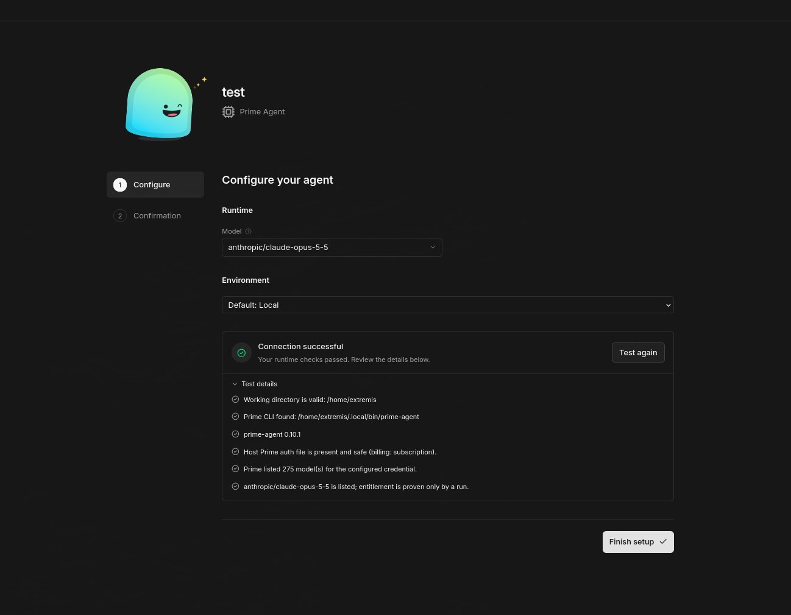
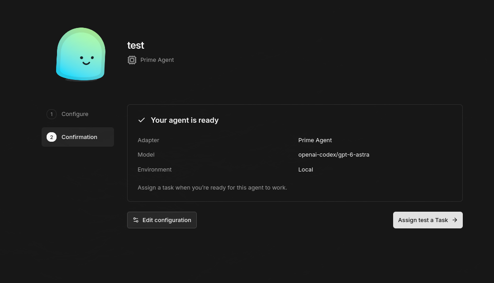
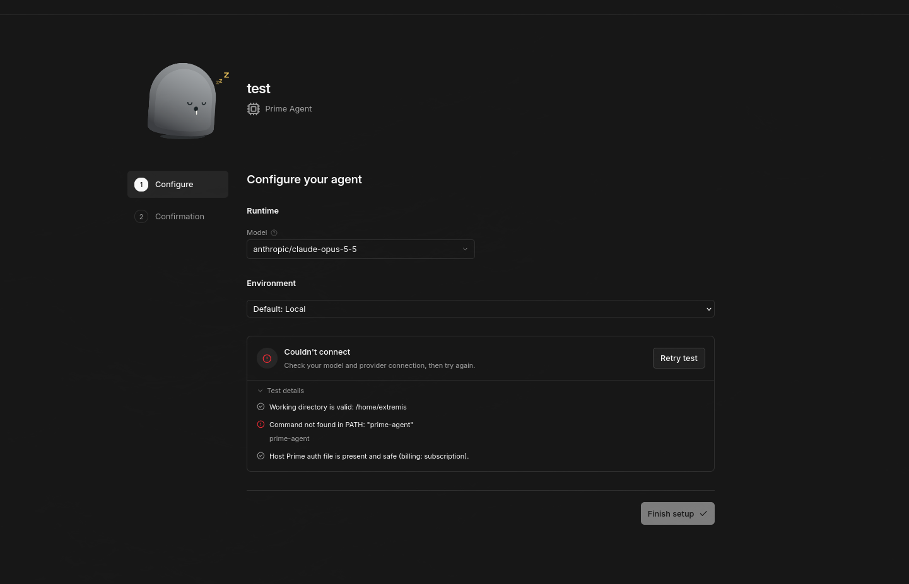

# Prime Agent adapter for Paperclip

`@deepextrema/paperclip-prime-local-adapter` is an external Paperclip adapter plugin. It adds the adapter type `prime_agent_local` (label "Prime Agent"). Each heartbeat runs stock `prime-agent` 0.10.x locally with `--mode json -p`, the way the built-in `pi_local` adapter runs Pi. The type is not `prime_local`, because a third-party adapter already uses that key.

## What it does

- Works for coordinators and specialists, with or without an issue.
- Each agent has its own Prime directory under the Paperclip company tree (settings, memories, sessions).
- Sessions resume per Paperclip task session when cwd, model and agent dir still match.
- Paperclip skills are passed with `--skill` for one run.
- The instructions bundle is appended with `--append-system-prompt`.
- The model list comes from `prime-agent model list`.
- The environment test makes no model call.
- Run logs render through the adapter's UI parser.

## Requirements

- Paperclip 2026.1005.0, with host `@paperclipai/adapter-utils` 0.3.1 under `$HOME/.paperclip/cli/installs/local/<version>/app/packages/adapter-utils`. `scripts/link-adapter-utils.mjs` holds the default path.
- Node.js 24.11.0 or newer.
- `prime-agent` 0.10.x runnable by the Paperclip server user.
- A Prime credential: a `prime-agent` login in `~/.prime/agent/auth.json`, or a provider API key.

## Quick start

```sh
npm ci
npm run build
scripts/install-local.sh --api-url http://127.0.0.1:3100/api
```

The agent's `model` must be a `provider/modelId` value listed by `prime-agent model list`.

### Creating an agent in the Paperclip UI

After `install-local.sh`, **Prime Agent** appears in Paperclip's adapter list. Pick a model (the dropdown is filled from `prime-agent model list` under the host's Prime credentials) and run the environment test:



Every check should be green: working directory, CLI path and version, host Prime auth file, model list, configured model. Finish setup and the agent is ready for a task:



`runtime` defaults to `print`. Set `adapterConfig.runtime` to `"daemon"` (Edit configuration → JSON, or the API) for runs that need Prime's delegation (`rlm.spawn`), goals/autonomy and memory; see the daemon row under Qualification for what is and is not covered.

**If the test reports `Command not found in PATH: "prime-agent"`:**



Paperclip is running as a service whose `PATH` lacks the directory holding `prime-agent`. Since commit `691ee1e` the adapter falls back to `~/.local/bin/prime-agent` on its own; if Prime is installed elsewhere, set `adapterConfig.command` to the absolute path. After upgrading the adapter, restart the Paperclip service so the new build is loaded (the API re-install alone does not reload cached modules).

## Documentation

- [Install](docs/install.md)
- [Configuration](docs/configuration.md)
- [Credentials](docs/credentials.md)
- [Troubleshooting](docs/troubleshooting.md)

## Security

- No containment: Prime runs as the Paperclip server user and the agent runs model-chosen code. A prompt is not a sandbox.
- With `credentialMode: "host_auth"` the agent can read the host Prime subscription token through its own `auth.json` link. With Prime 0.10 the link does not survive a token refresh; see [credentials](docs/credentials.md#host_auth-unsafe-with-prime-010).
- The agent's environment holds a short-lived `PAPERCLIP_API_KEY`.
- Use `credentialMode: "api_key"` with a dedicated key when isolation matters.
- `credentialMode: "managed_subscription"` shares the host's Claude subscription with every agent on it, and needs `featureProfile: "governed-v1"`. See [credentials](docs/credentials.md#managed_subscription).
- `featureProfile: "governed-v1"` limits what one run can leave for the next (settings, context files, skills, agent-dir files, schedules, goals, harness entries), checks the model catalog, and reports the rest in `resultJson.featureProfile.warnings`. It is not a sandbox. See [configuration](docs/configuration.md#feature-profile-governed-v1).

## Qualification

Claim levels: registered/loaded, deterministic-qualified, live-qualified; anything else is not qualified.

| Surface | Claim level | Evidence |
|---|---|---|
| Plugin shape expected by Paperclip's loader (`createServerAdapter`) | deterministic-qualified | `test/contract.test.ts` |
| Plugin registered and loaded by Paperclip 2026.1005.0 (POST /api/adapters/install, throwaway instance) | registered/loaded | WP7 smoke check "adapter loaded from external plugin" |
| Symlinked staged skill directory (`--skill`) | not qualified | PARTIAL: --skill with a symlinked staged dir accepted by prime-agent 0.10.0; skill loading by the model not observed. Specialist run argv and success recorded in WP7 smoke. |
| Config, credentials, env hygiene, argv, JSONL parsing, session codec, skills, models, environment test, UI parser | deterministic-qualified | unit tests in `test/` against captured prime-agent 0.10.0 output |
| Coordinator wake without an issue, specialist wake on the created issue, two agents at once on one symlinked subscription (throwaway Paperclip 2026.1005.0, prime-agent 0.10.0, anthropic/claude-haiku-4-5, thinking off, 2026-10-18) | live-qualified | WP7 smoke attempt-1 and attempt-2 (after F1): every run, concurrency, cleanup and live-state check passed both times (23 of 24 checks; the one failure is the model-list row below). |
| Host model list (`listModels()` without agent context) | not qualified | The smoke check `model list includes the smoke model` failed in both attempts and cannot pass inside this harness: `listModels()` uses the server `HOME`, which the smoke points at an empty throwaway home (no user-local `prime-agent`, no `auth.json`). Under the live service environment (real user home, service `PATH` without the user-local bin) the F1 fallback resolved the user-local `prime-agent` and the built `listPrimeModelsForAdapter()` returned 275 models including the smoke model (direct call, 2026-10-18). A model-list check on the live host is part of the WP8 cutover. |
| Plugin registered on the owner's live Paperclip 2026.1005.0 (POST /api/adapters/install, local path, no service restart); live model list (275 models); environment test 6/6; one coordinator wake with `runtime` absent (print), `openai-codex/gpt-6-luna`, thinking off (2026-10-21) | live-qualified | Slice 1 evidence `plan-audit/slice1-evidence/` (run `e1bf11b0`, succeeded, 21 s). When Paperclip runs as a systemd service its `PATH` lacks `~/.local/bin`; since the fix below, the default command falls back to `~/.local/bin/prime-agent` for execute, the daemon runtime and the environment test (as the model list already did), so the setup wizard passes without an explicit `adapterConfig.command`. |
| `runtime: "daemon"` (opt-in; default stays `print`): one `prime-agent --mode daemon` per run on a short per-run socket, `create`/`attach`/`prompt_and_wait`, wait for child sessions by roster state, last text + stats (depth-2 child usage), `shutdown` then forced cleanup of daemon and worker process groups; child spawn (`rlm.spawn`) reply in the run result; issue-scoped task session params persisted; no daemon left after the run (throwaway Paperclip, prime-agent 0.10.0, run `48c4e5b1`, 2026-10-21) | live-qualified | `plan-audit/2026-10-18-slice2-report.md`, `execution-daemon-per-run/`, real-daemon cleanup probe `09-real-cleanup.json`; independent review `plan-audit/2026-10-18-slice2-code-review.md` ACCEPT at `05ce4b9`. Known limits: a child reply still in flight when the roster shows the child terminal and the parent idle is not waited for (bounded false success, no timer); child workers started mid-turn are learned only after the turn; a non-zero daemon exit waits the fixed `graceSec` (default 20 s). Live host (owner's Paperclip, agent `Prime Agent (daemon)`, 2026-10-21): run 1 `273d754e` returned `CHILD SAID OSPREY-9` with the child spawned and collected inside the run; run 2 `5577da20` (issue-scoped repair wake) reused the session and returned `MEMORY SAYS ... OSPREY-9`; no daemon left after either run (`plan-audit/slice3-evidence/`). Goal activation and serialized refine: not observed. Coordinator wakes without an issue start a fresh session by Paperclip design (PF-4); resume needs an issue-scoped run. |
| 0.2.0 (TAI-273): `credentialMode: "managed_subscription"` and its fail-closed rule; `featureProfile: "governed-v1"` items 1-12 (managed keys, session cap, report, schedules, settings allowlist, context files and workspace config, goals, harness strip, agent skills, skill list and its checks, agent-dir allowlist and catalog caches, model catalog and thinking level); G1 skill names; G3 fresh-session, held-lease and `clearSession` rules and the persistent-shell reap; G4 run-log rendering | deterministic-qualified | `test/governed.test.ts`, `test/managed-connection.test.ts`, `test/skills.test.ts`, the golden test and the updated unit tests, against the fake daemon and fake print agent. The Prime facts they rely on were taken offline on prime-agent 0.10.1 (`docs/n0-prime-0.10.1.md`, `scripts/n0/`). Live runs, the host registration on the running server and Anthropic's acceptance of the token: not qualified (canary pending). |
| `allowedModels`: managed `settings.json` keys, `prime_settings_invalid`/`_tampered`, `auth.json` check, per-actor model audit from session files on every outcome, `sk-ant-oat` subscription label, key removed from Prime's environment, model list without the host login | deterministic-qualified | `test/model-policy.test.ts` and the updated unit tests, against the fake daemon and fake print agent. Not yet run against prime-agent 0.10.1: the session-file shape (`type: "message"` lines with `message.provider`/`message.model`) was read from existing 0.10.x session files, and child session files reported by `get_session_stats`/`list` are `unverified` until a live child run. |

## License

MIT, see `LICENSE`. The structure follows Paperclip's MIT-licensed `pi-local` adapter.
